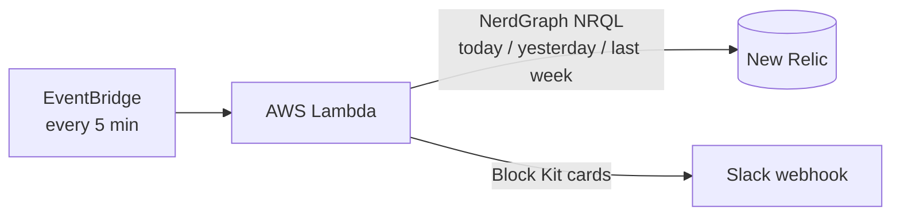

# API Error-Rate Spike Alerts (New Relic → Slack)

**A serverless, stateless alerting system that catches error spikes on individual APIs, not just whole services, and posts clear, de-duplicated Slack cards.**

Runs in production on AWS Lambda, checking every 5 minutes across multiple New Relic accounts.

  
  

## The problem
Service-level dashboards hide trouble. One API can start failing badly while the service-wide error rate still looks fine. Fixed thresholds ("alert at 5% errors") are also noisy, because some endpoints always fail a little and others never should.

## The solution
Each API (service + transaction name) is compared against **its own history**. An alert opens only when the error rate in the last 60 minutes is at least **2x the same window yesterday AND last week**. That filters out normal daily and weekly patterns.

- **Per-API granularity:** every service + endpoint is tracked separately.
- **Self-baselining:** no thresholds to hand-tune per endpoint.
- **Noise control:** minimum-error counts per window, so a handful of failures on a quiet endpoint doesn't trigger an alert.
- **No duplicate alerts:** a spike opens once, and a resolved card is sent when it ends.
- **Stateless:** no database. Each run compares the current window with the one 5 minutes earlier to detect state changes.
- **Multi-account:** one deployment monitors several New Relic accounts and routes each to its own Slack webhook.

## Architecture

## How detection works
1. Pull errors and request counts per API in 5-minute slices for today, yesterday and last week (3 parallel queries per account).
2. Compute the error rate for the current window and compare it with the same window on each reference day.
3. Open an alert if the rate is at least 2x the reference (the higher of the two by default) and the error count is above the minimum.
4. Compare with the window 5 minutes ago to decide: **new spike**, **worsened** (WARNING → CRITICAL), **resolved**, or **ongoing** (no message).

## Engineering details
- Collapses IDs, UUIDs and emails in URLs (`/users/48213` → `/users/{id}`), so one API is one row.
- Sanitizes names before posting to Slack, preventing formatting injection and accidental `@mentions`.
- Splits large alert bursts into several Slack messages, so none are dropped.
- Skips the newest 2 minutes of data to allow for ingestion delay.
- A failure in one account doesn't stop the others.
- Built-in operational actions: `test`, `coverage` (lists services that aren't monitored), `install` / `uninstall` (creates the EventBridge schedule itself).
- Standard library only (`boto3` is already in Lambda), so there are no dependencies to package.

## Tech
Python · AWS Lambda · Amazon EventBridge · New Relic NerdGraph / NRQL · Slack Block Kit

## Setup
1. Create a Python 3.12 Lambda with handler `lambda_function.lambda_handler`, and set the timeout to 2-3 minutes.
2. Paste in `lambda_function.py`.
3. Add environment variables:

| Variable | Example | Purpose |
|---|---|---|
| `NR_ACCOUNTS` | `account_a:1234567:Account A` | `key:accountId:Label`, comma separated |
| `NR_API_KEY_ACCOUNT_A` | `NRAK-...` | New Relic User API key for that account |
| `SLACK_WEBHOOK_ACCOUNT_A` | `https://hooks.slack.com/...` | Slack webhook for that account |
| `INCLUDE_APPS` | `my-service` | Optional: services without "prod" in the name |
| `EXCLUDED_APPS` | `noisy-service` | Optional: services to ignore |
| `WINDOWS_MIN` | `60` | Optional: windows to check, e.g. `5,30,60` |
| `DRY_RUN` | `true` | Optional: log instead of posting |

4. Test with `{"action":"test","sample":true}`. This posts sample cards to Slack.
5. Create the schedule with `{"action":"install"}`. The Lambda role needs `events:PutRule`, `events:PutTargets` and `lambda:AddPermission`. Alternatively, create a `rate(5 minutes)` EventBridge rule by hand.

Other events: `{"action":"coverage"}` and `{"action":"uninstall"}`.

## Security
Keys and webhooks live only in Lambda environment variables and are never committed. Use a read-only New Relic User API key.