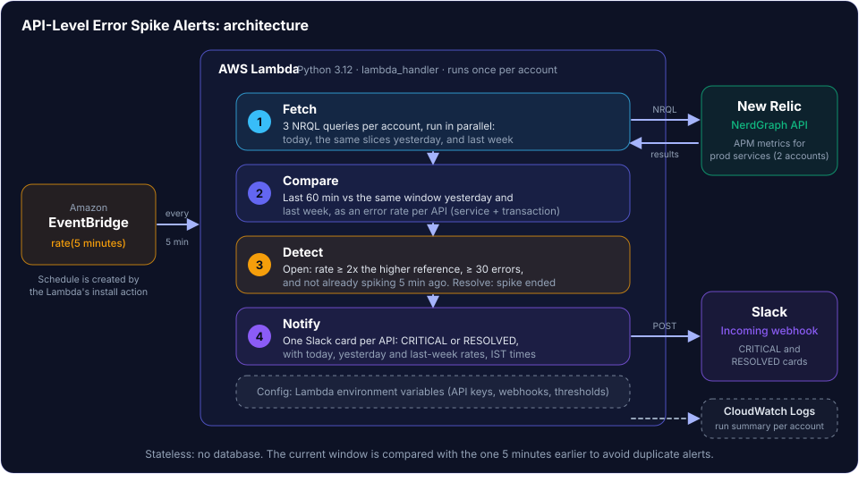
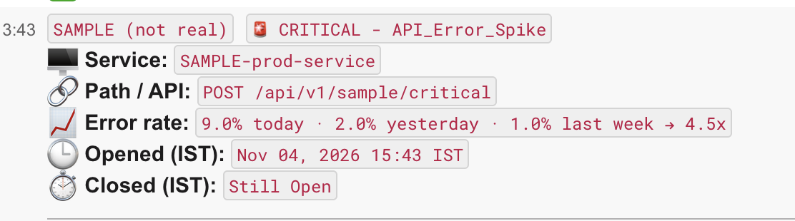
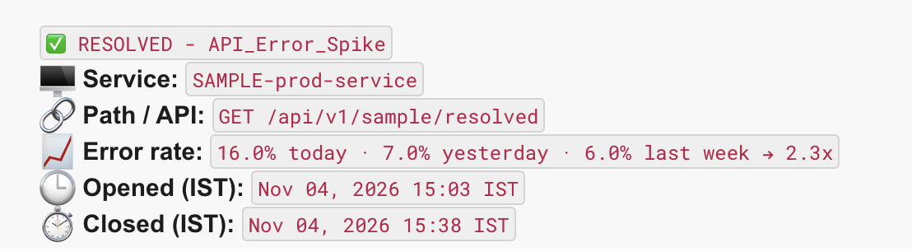

# New Relic API Error-Rate Spike Alerts

An AWS Lambda that checks New Relic every 5 minutes and posts a Slack card when an
API's error rate is at least 2x the same window **yesterday and last week**. It posts a
RESOLVED card when the spike ends. The Lambda keeps no state and needs no database.

## How it works
1. EventBridge triggers the Lambda every 5 minutes.
2. It queries New Relic (NerdGraph) for errors and requests per API (service + transaction name), in 5-minute slices.
3. It compares the last 60 minutes with the same window yesterday and last week.
4. An alert opens when the error rate is at least 2x the higher of the two references and the window has enough errors to matter (default 30 errors for a 60-minute window).
5. It does not alert again while the spike continues: it compares the current window with the one 5 minutes earlier. It resolves when the spike ends.
6. Cards go to Slack through an incoming webhook, with IST timestamps.

Services covered: every service whose name contains "prod" (any case), plus any names in `INCLUDE_APPS`.
Transaction names are cleaned so one API is one row (IDs, UUIDs and emails become `{id}` / `{email}`).

## Setup
1. Create a Python 3.12 Lambda. Handler: `lambda_function.lambda_handler`. Timeout: 2-3 minutes.
2. Paste in `lambda_function.py`.
3. Add environment variables:

| Variable | Example | Purpose |
|---|---|---|
| `NEW_RELIC_API_KEY_A` / `_B` | `NRAK-...` | New Relic User API key per account |
| `NR_ACCOUNT_ID_A` / `_B` | `1234567` | New Relic account IDs |
| `SLACK_WEBHOOK_A` / `_B` (or `SLACK_WEBHOOK`) | `https://hooks.slack.com/...` | Slack incoming webhook |
| `INCLUDE_APPS` | `my-service` | optional: services without "prod" in the name |
| `EXCLUDED_APPS` | `noisy-service` | optional: services to ignore |
| `WINDOWS_MIN` | `60` | windows to check, multiples of 5 (e.g. `5,30,60`) |
| `WARN_RATIO` / `CRIT_RATIO` | `2` | spike = rate >= ratio x reference |
| `HISTORY_COMPARE` | `both` | `both` (higher of yesterday/last week) or `any` (lower) |
| `MIN_ERRORS` | `30` | optional: override the minimum errors per window |
| `NR_REGION` | `EU` | optional: EU data centre |
| `DRY_RUN` | `true` | optional: log instead of posting |

4. Test with `{"action":"test","sample":true}` (checks keys and Slack, posts sample cards).
5. Create the 5-minute schedule with `{"action":"install"}`. The Lambda role needs
   `events:PutRule`, `events:PutTargets` and `lambda:AddPermission`. Or create the EventBridge rule by hand.

## Other test events
- `{"action":"coverage"}` lists services with traffic that are not monitored
- `{"action":"uninstall"}` removes the schedule

## Limitations
- The dedupe is stateless, so an alert opens only in the run where the spike first appears. If that run fails or is skipped, that alert is missed. Add a CloudWatch alarm on Lambda errors.
- A failed Slack post is not retried.
- A 60-minute window reacts more slowly to short spikes. Add `5` or `30` to `WINDOWS_MIN` for faster detection.

## Security
Keys and webhooks live only in Lambda environment variables. Never commit them or real account IDs.